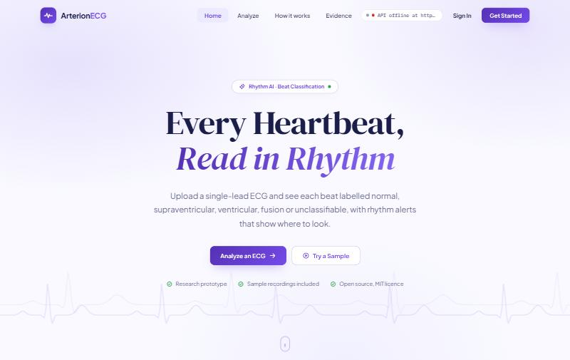

# Arterion ECG Monitor

[](https://github.com/kartikpagariya25/arterion-arrhythmia/actions/workflows/test.yml)  

Beat-by-beat arrhythmia classification for single-lead ECG, with rhythm-level alerts (ventricular tachycardia, bigeminy, trigeminy, AFib-like irregularity, tachy/bradycardia). Upload a CSV, get a scrolling trace with every beat labelled N / S / V / F / Q.



> **Research prototype — not a medical device.** Do not use for diagnosis or treatment decisions.

Part of the [Arterion](https://github.com/kartikpagariya25/Arterion) project.

## How it works

1. Band-pass filter (0.5–40 Hz), R-peak detection (NeuroKit2).
2. Each beat (256 samples at 360 Hz around the R peak) plus four R-R interval features goes through **CardioNet**, a small 1D residual CNN (498 k parameters), exported to ONNX.
3. Beat classes follow AAMI: **N** normal, **S** supraventricular ectopic, **V** ventricular ectopic, **F** fusion, **Q** unclassifiable.
4. A rule engine turns the beat sequence into rhythm alerts. It deliberately ignores windows containing ectopic beats when judging AFib-style irregularity, because PVCs alone make R-R intervals irregular.

## Results — honest numbers

Trained on MIT-BIH DS1 (22 records), tested on the **disjoint DS2 records (49,692 beats, inter-patient)** — the evaluation that matters clinically.

| Class | Sensitivity | PPV | F1 | Beats in test |
|---|---|---|---|---|
| N normal | 0.933 | 0.962 | 0.947 | 44,240 |
| S supraventricular | **0.238** | 0.190 | 0.211 | 1,837 |
| V ventricular | **0.943** | 0.825 | 0.880 | 3,220 |
| F fusion | **0.028** | 0.013 | 0.018 | 388 |
| Q unclassifiable | 0 | 0 | 0 | 7 |

Accuracy 0.900, macro-F1 **0.411**. The model is good at telling ventricular ectopy from normal beats (the target was V sensitivity ≥ 0.85) and **poor at supraventricular and fusion beats** — a known weakness of inter-patient MIT-BIH evaluation. A random beat-level split of the same data gives macro-F1 0.758; that gap is leakage between patients, which is why it is not the headline number. Full metrics and the confusion matrix are in `training/artifacts/`.

Rhythm alerts come from hand-written rules and have not been validated against annotated rhythm episodes.

## Accounts, history and the doctor dashboard

Sign in from the top of the site to keep a history of your ECG analysiss. Without an account everything still works; results just are not saved.

- **Patients** register with an email and password. Every analysis they run while signed in is saved (the findings, not images or long signals) and listed on `history.html`, together with any note a doctor adds. They can delete single analyses, change their password or delete their account and all of its data.
- **Doctors** get a dashboard on the same page: *Awaiting review*, *All analyses* (filter by type, status or patient), *Patients* and *My analyses*. They open any analysis and write a review note that the patient sees.
- **Doctor sign-up needs an invite code.** Set `DOCTOR_INVITE_CODE` on the backend; with it unset, doctor registration is disabled. To create the first doctor (or reset a forgotten password; there is no email reset):

```bash
cd backend
python -m app.accounts.cli create-user --email doc@example.com --name "Dr Doc" --role doctor
python -m app.accounts.cli set-password --email someone@example.com
```

Under the hood: SQLite, passwords hashed with scrypt, HS256 JWTs, and a lockout after five failed logins per email (15 minutes). See [SECURITY.md](SECURITY.md) for what this does and does not protect.

| Setting | Default | Meaning |
|---|---|---|
| `DATA_DIR` | `backend/data` (a Docker volume in compose) | where `arterion.db` and the generated JWT secret live |
| `JWT_SECRET` | generated once, kept in `DATA_DIR` | signing key; set it to share tokens between replicas |
| `JWT_EXPIRE_MINUTES` | `480` | token lifetime |
| `DOCTOR_INVITE_CODE` | empty (doctor sign-up off) | code required to register as a doctor |
| `REQUIRE_AUTH` | off | `1` makes every endpoint, uploads included, require a signed-in user |

| Endpoint | Who | Purpose |
|---|---|---|
| `POST /auth/register`, `POST /auth/login` | anyone | create an account / get a token |
| `GET /auth/me`, `POST /auth/password`, `DELETE /auth/me` | signed in | profile, change password, delete account and data |
| `GET /history`, `GET /history/{id}`, `DELETE /history/{id}` | signed in | the caller's own saved analyses |
| `GET /doctor/patients`, `GET /doctor/analyses[/{id}]` | doctor | all patients and their analyses |
| `POST /doctor/analyses/{id}/review` | doctor | add or update a review note |

Prediction endpoints take an optional `Authorization: Bearer <token>`; when present the result is saved and the response carries an `X-History-Id` header.

## Run it

```bash
./scripts/fetch_weights.sh        # or .\scripts\fetch_weights.ps1  (downloads from the GitHub Release)
docker compose up --build
# site: http://localhost:8080     API docs: http://localhost:8000/docs
```

Without Docker: `cd backend && pip install -r requirements-dev.txt && uvicorn app.main:app --port 8000`, then serve `frontend/` (e.g. `python -m http.server 8080`). The site talks to `window.API_BASE` in `frontend/js/config.js`.

Two sample recordings (20 s of MIT-BIH records 100 and 119) are bundled; the site has buttons for them.

### API

| Endpoint | Body | Returns |
|---|---|---|
| `POST /uploads` | multipart `file` | `{file_url}` |
| `POST /arrhythmia/predict` | `{file_url, sampling_rate=360}` | rhythm, per-beat classes, counts, heart rate, alerts, decimated signal for plotting |
| `GET /arrhythmia/samples[/{name}]` | – | bundled sample CSVs |

Input is one lead as CSV/text; a header row and a time/index column are tolerated. Files shorter than 2 s are rejected (422); under 10 s returns a warning. Non-numeric files return 422 with a readable message.

Tests: `cd backend && pytest tests` (51 tests, including the original preprocessing and rule tests).

## Training

`training/` contains the whole pipeline: `dataset_builder.py` → `train.py` (focal loss, AdamW, cosine schedule, early stopping on validation macro-F1) → `evaluate.py` → `export_onnx.py` (parity-checked). See `training/IMPLEMENTATION.md`.

## Documentation

- [Model card](MODEL_CARD.md): data, results and limitations
- [Changelog](CHANGELOG.md)
- No Docker? Run `scripts/run_local.ps1` (Windows) or `scripts/run_local.sh` (macOS/Linux); it creates a virtual environment, starts the API on 8000 and the site on 8080. Needs Python 3.11.
- [Contributing](CONTRIBUTING.md)
- [Security and privacy](SECURITY.md)

## Data and licences

Code: MIT. Model trained on the [MIT-BIH Arrhythmia Database](https://physionet.org/content/mitdb/1.0.0/) (Moody & Mark, PhysioNet; Open Data Commons Attribution). The bundled samples are excerpts of records 100 and 119.
